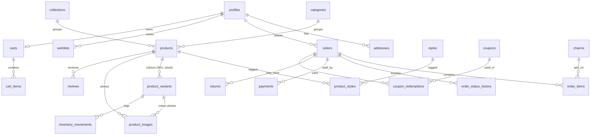

# Architecture

## Folder structure

```
app/
  (store)/            Storefront: home, shop, product, cart, checkout, account, help, contact,
                      journal, CMS pages, wishlist, search, order tracking
  (auth)/             login, signup, forgot/reset password, auth/callback (OAuth + email links)
  admin/              Admin panel (dynamic, staff only)
  api/
    razorpay/webhook  Payment webhook (signature-verified, idempotent, logged)
    track             First-party analytics beacon
    search            Predictive search
    pincode           Delivery estimate
    invoice/[n]       GST invoice / packing slip PDF
    admin/export      CSV exports
    cron/daily        Daily jobs (abandoned-cart emails, low stock, housekeeping)
    revalidate        On-demand cache refresh for external webhooks
  sitemap.ts robots.ts manifest.ts icon.png apple-icon.png not-found.tsx error.tsx global-error.tsx
components/
  ui/                 Buttons, inputs, badges, sheet/modal (shadcn-style, brand themed)
  store/              Storefront components (home/, product/, shop/, checkout/, account/, order/)
  admin/              Admin shell, tables, forms, charts, image manager, rich text
lib/
  data/               Cached read functions ("use cache" + cache tags)
  actions/            Server Actions (store + admin/), all Zod-validated
  supabase/           Browser, server, admin (service role), public clients + generated types
  payments/ orders/   Razorpay, refunds, invoices, notifications, abandoned carts
  email/  analytics/  Resend sender, beacon client, UA parser
  demo/seed-data.ts   Sample catalogue (also used for demo mode, seed.sql and artwork)
  auth.ts env.ts validations.ts rate-limit.ts utils.ts types.ts
emails/               React Email templates
supabase/
  migrations/         0001 helpers → 0007 cron (run in order)
  seed.sql            Generated sample catalogue/content
  seed-demo-analytics.sql  Optional sample orders + events
  templates/          Branded Supabase Auth emails
scripts/              generate-images.ts, generate-seed.ts
proxy.ts              Next.js 16 proxy (formerly middleware): session refresh + /admin, /account guards
```

## Request and data flow

```mermaid
flowchart LR
  B[Browser] -->|static HTML from CDN| V[Vercel edge]
  V -->|cache miss / dynamic| N[Next.js server]
  N -->|"use cache" reads (anon key, RLS)| S[(Supabase Postgres)]
  B -->|Server Actions| N
  N -->|service role: create_order, mark_order_paid| S
  B -->|checkout.js| R[Razorpay]
  R -->|webhook| N
  N -->|emails| E[Resend]
  B -->|sendBeacon /api/track| N
  B -->|image uploads (staff/user session)| ST[(Supabase Storage)]
```

**Checkout, step by step**

1. The bag lives in the browser (Zustand + localStorage). Prices shown there are for display only.
2. `quoteCheckout` re-prices the bag on the server (database prices, coupon, shipping, COD fee).
3. `placeOrder` (Zod + rate limit) calls the Postgres function **`create_order()`**. In one transaction it locks variant rows, decrements stock with `stock >= qty` guards (so there's no overselling), applies the coupon, computes GST and writes the order, items, history and inventory movements. Any failure rolls everything back.
4. For Razorpay, a Razorpay order is created for the exact total and the payment window opens.
5. `verifyPayment` checks the HMAC signature, fetches the payment from Razorpay to confirm the amount, and calls **`mark_order_paid()`** (idempotent, amount-checked). The webhook does the same independently, so payments are confirmed even if the tab is closed.
6. Unpaid orders are released after 45 minutes by `release_stale_pending_orders()` (pg_cron, plus the daily Vercel cron as a fallback).
7. After the response is sent, emails go out and the affected product pages are revalidated.

## Database



Other tables: `hero_slides`, `site_settings` (JSON per key), `pages`, `journal_posts`, `faqs`, `contact_messages`, `newsletter_subscribers`, `analytics_events`, `audit_logs`, `payment_webhook_logs`, `rate_limits`.

**Security (Row Level Security on every table)**

- **Public (anon)**: reads only published products (respecting `publish_at`), their variants and images, visible taxonomies, active charms and slides, approved reviews, public settings, and published pages, posts and FAQs.
- **Customers**: their own profile (a trigger blocks role or block-status changes), addresses, wishlist, cart, orders, order items, visible history and returns. They can create reviews only for delivered purchases.
- **Staff/admin** (`is_staff()`): full access. Only admins can change `site_settings` and roles.
- **Service role** (server only): order creation and payment functions, whose `execute` permission is revoked from everyone else.
- **Storage**: `product-images` and `cms-images` are publicly readable and writable by staff. Customers can upload only to `reviews/<their-uid>/` and `returns/<their-uid>/`. `invoices` is private.

**Analytics** runs on SQL functions that return JSON in a single round trip (`analytics_kpis`, `analytics_sales_series`, `analytics_report`, `analytics_realtime`, `admin_tracker_counts`). Two **materialized views** (`mv_daily_sales`, `mv_product_stats`) are refreshed every 15 minutes. The sales series uses the view for past days and live data for today.

**Migrations were tested** on PostgreSQL 16 with a Supabase-compatible stub (auth, storage and roles). The tests covered server-side pricing, coupon caps and per-customer limits, oversell rejection with full rollback, stock restoration on cancel, stale-order release, late-payment re-reservation, amount-mismatch rejection, idempotent payment marking, rate limiting, guest-order linking on email confirmation, role-escalation blocking, customer-only order visibility, and admin-only settings writes.

## Caching and revalidation

Next.js 16 **Cache Components** (`cacheComponents: true`) with Partial Prerendering:

| Data                                   | Function                              | Lifetime | Tag(s)                       |
| -------------------------------------- | ------------------------------------- | -------- | ---------------------------- |
| All product cards (shop, home, search) | `getAllProducts`                      | hours    | `products`                   |
| One product                            | `getProductBySlug`                    | hours    | `products`, `product:<slug>` |
| Categories / styles / collections      | `getCategories`…                      | max      | `taxonomies`                 |
| Charms                                 | `getCharms`                           | max      | `charms`                     |
| Reviews                                | `getProductReviews`                   | hours    | `reviews:<productId>`        |
| Settings                               | `getSiteSettings`                     | max      | `settings`                   |
| Hero, FAQs, pages                      | `getHeroSlides`, `getFaqs`, `getPage` | max      | `content`, `page:<slug>`     |
| Journal                                | `getJournalPosts`, `getJournalPost`   | hours    | `journal`, `post:<slug>`     |

- Every admin Server Action calls `updateTag()` for what it changed (read-your-own-writes), so the store updates instantly.
- New orders call `revalidateTag("product:<slug>", "max")` so stock badges refresh in the background.
- An "hours" lifetime on products makes scheduled products appear within the hour without anyone acting.
- Home, product, journal and CMS pages are **fully static** (prerendered at build and for every slug from `generateStaticParams`). Shop and filter pages serve a static shell and stream the filtered grid (search params are request data).
- Cookies are only read inside `<Suspense>` boundaries (account, order pages) or in the admin, which uses `instant = false`. The storefront layout never reads cookies, so it stays on the CDN.
- `proxy.ts` runs only on `/admin`, `/account`, `/checkout` and auth routes, so it adds no latency to shopping pages.

## Performance techniques

- Server Components by default. Client islands are small (header icons, carousels, wishlist hearts, product purchase panel).
- Loaded only on use: search overlay, mini bag (with Framer Motion), mobile menu, filter drawer, lightbox, review form, 360° viewer, video, map, Razorpay script, Supabase browser SDK (only when uploading a photo), and Recharts (admin only).
- Images: `next/image` with AVIF/WebP, correct `sizes`, a blur placeholder, an art-directed hero (`<picture>` with media-targeted preloads), `fetchPriority="high"` only on the LCP image, and other hero slides mounted when the browser is idle.
- Fonts: `next/font` self-hosted variable fonts. Only the display serif is preloaded, and the body font uses metric-matched fallbacks (no CLS).
- Admin code is in its own route segment and never ships to shoppers.

## Performance results

Measured on this machine against `next build && next start` (localhost, Windows), with Lighthouse 12 in **mobile** mode.

| Page    | Performance (simulated 4G) | Performance (applied throttling) | Accessibility | Best practices | SEO | LCP (applied) | CLS |
| ------- | -------------------------- | -------------------------------- | ------------- | -------------- | --- | ------------- | --- |
| Home    | 88–90                      | 93                               | 100           | 100            | 100 | 2.0 s         | 0   |
| Product | 86–89                      | 91                               | 100           | 100            | 100 | 2.3 s         | 0   |
| Shop    | 86–88                      | 96                               | 100           | 100            | 100 | 2.2 s         | 0   |
| Help    | 90                         | —                                | 100           | 100            | 100 | —             | 0   |

The simulated score is bounded by the ~210–225 KB of JavaScript (React and the Next.js runtime are about 116 KB of that) competing with the hero image on a simulated slow-4G link. Real network timings on the same runs put the hero image fully loaded at about 0.3 s. Re-run Lighthouse on the live Vercel deployment (HTTP/2, Brotli, edge cache) for production numbers.

**Bundle analysis**: run `npm run analyze` (the Turbopack analyzer) to explore modules by route. Storefront first-load JS by page: home ≈ 223 KB, product ≈ 223 KB, shop ≈ 208 KB, help ≈ 210 KB (compressed transfer, all chunks).
