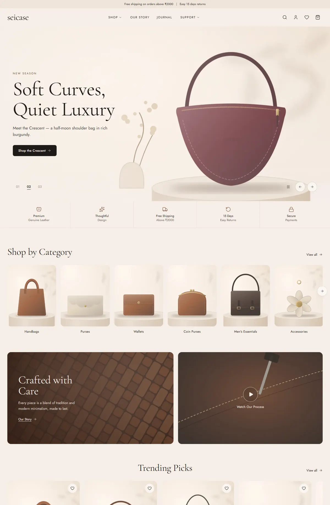
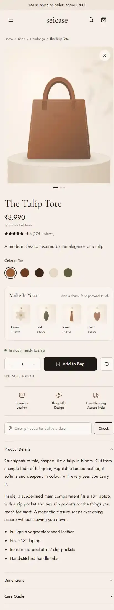
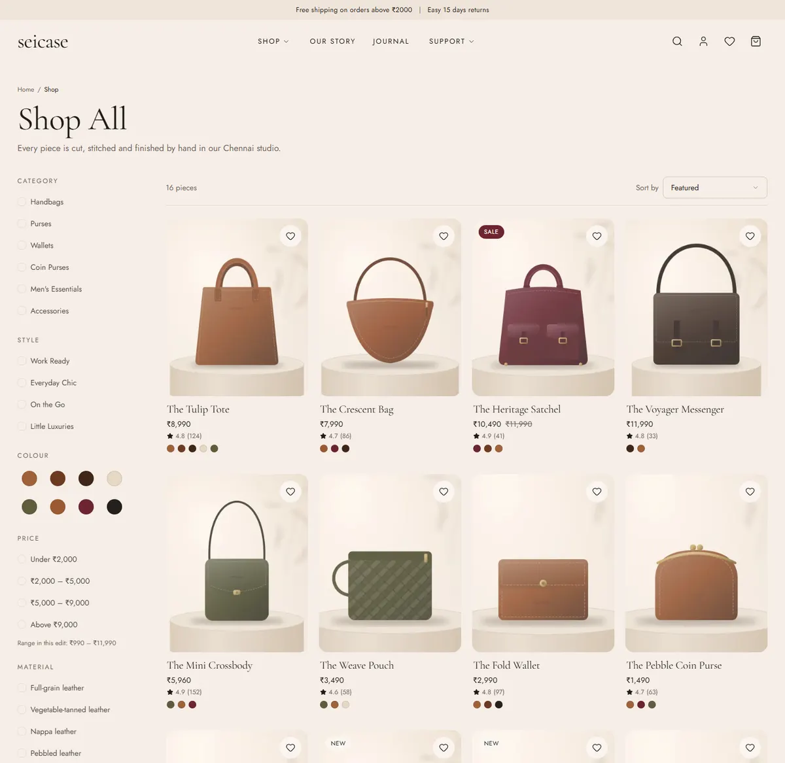
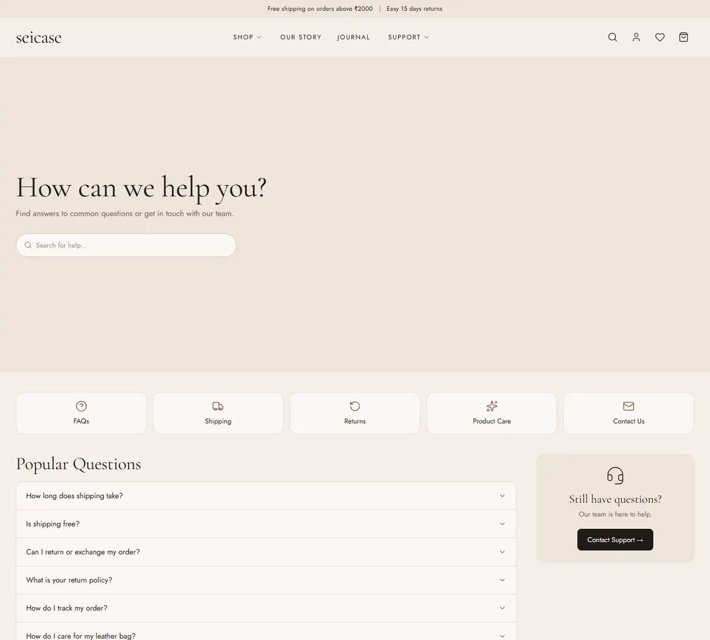

# seicase: project overview

seicase is a complete online store for premium leather bags and accessories. It has three parts:

1. **The storefront**, which customers see and shop on.
2. **The admin panel** at `/admin`, where you and your team run the business.
3. **Analytics and trackers** inside the admin panel, showing sales, visitors and anything that needs attention.

Everything is in rupees (₹), uses Indian address and pincode rules, and includes GST in its prices.

| Home (desktop)                         | Product page (mobile)                                 |
| -------------------------------------- | ----------------------------------------------------- |
|  |  |

| Shop with filters              | Help Centre                    |
| ------------------------------ | ------------------------------ |
|  |  |

---

## What customers can do

**Browsing**

- Home page with a 3-slide hero (numbered 01/02/03, arrows, swipe), a trust strip, Shop by Category, Crafted with Care with a "Watch Our Process" video, Trending Picks, Shop by Style, a "More Than a Bag" banner and newsletter signup.
- Shop pages for all products, each category (including New In) and each style. Filters cover colour, price, material, stock and style, with sorting. Filters are stored in the address bar, so links can be shared and indexed by Google.
- Instant search with thumbnails, plus recent and popular searches. Every search is logged so you can see what customers look for.

**Product page**

- Photo gallery with thumbnails, zoom on hover or tap, swipe on mobile, and a full-screen view.
- 360° drag-to-rotate view (when you upload an image sequence), plus Details and Dimensions tabs.
- Colour swatches. Each colour has its own photos, SKU and stock, and the page shows "Only X left" when stock is low.
- "Make It Yours" charms (flower, leaf, tassel, heart) that are added to the bag together with it.
- Delivery-date check by pincode, reviews with photos from verified buyers, You May Also Like and Recently Viewed.
- A sticky "Add to Bag" bar on phones.

**Buying**

- Slide-in mini bag, full bag page, a free-shipping progress bar, discount codes and move-to-wishlist.
- Checkout as a guest or signed in, with saved addresses, Indian states and pincode validation (the city fills in automatically).
- Payment through **Razorpay** (UPI, cards, netbanking, wallets) or **Cash on Delivery** (optional).
- Every price and stock level is checked again on the server. Stock is reserved atomically, so two people can never buy the last bag.
- Confirmation page and confirmation email. Abandoned-cart reminder emails go out automatically.

**After buying**

- My Account: orders with a tracking timeline, invoice PDF download, cancellation (before shipping), return and exchange requests, wishlist, address book and account details.
- Sign in with email and password, a magic link, Google, or phone OTP (optional).
- Guests can track their order from the link in their email.

**Content pages**: Help Centre (searchable FAQs), Contact (form, map, details), Our Story, Journal, Care Guide, Shipping Policy, Returns & Exchanges, Privacy Policy and Terms. All of them are editable in the admin panel.

## What you can do in the admin panel

| Area                                                       | What it does                                                                                                                                                                                                                         |
| ---------------------------------------------------------- | ------------------------------------------------------------------------------------------------------------------------------------------------------------------------------------------------------------------------------------ |
| Dashboard                                                  | Revenue, orders, conversion and profit compared with the previous period. Sales chart, funnel, alerts, live visitors and orders.                                                                                                     |
| Analytics                                                  | Every report: top products, categories, colours, traffic sources, UTM campaigns, devices, cities and states, searches (including ones with no results), wishlists, abandoned carts, coupons and cohorts. Each report exports to CSV. |
| Orders                                                     | List or board (kanban) view, filters, status updates that email the customer, tracking numbers, refunds, notes, invoice and packing slip.                                                                                            |
| Returns                                                    | Approve or reject requests, receive items, refund (Razorpay refunds happen automatically) and put items back into stock.                                                                                                             |
| Products                                                   | Create, edit, duplicate, archive, schedule publishing and run bulk actions. Colours with SKU and stock, drag-and-drop photos (compressed automatically), 360° sequences, SEO fields, CSV import and export, inline stock editing.    |
| Inventory                                                  | Stock per colour, low and out-of-stock alerts, adjustments with a reason, and full movement history.                                                                                                                                 |
| Categories, styles, collections, charms, coupons, reviews  | Full management of each.                                                                                                                                                                                                             |
| Content                                                    | Hero slides, announcement bar, homepage section order and visibility, trust strip, banners, journal, pages and FAQs.                                                                                                                 |
| Messages, newsletter, payments, abandoned carts, customers | Inboxes and trackers, each with CSV export.                                                                                                                                                                                          |
| Settings                                                   | Store info, shipping and COD rules, social links, notifications, integration status, test emails, and staff roles.                                                                                                                   |
| Audit log                                                  | Who changed what, and when.                                                                                                                                                                                                          |

## Technology (in plain words)

| Part                     | Service                                                       | Why                                                                         |
| ------------------------ | ------------------------------------------------------------- | --------------------------------------------------------------------------- |
| Website                  | **Next.js 16** on **Vercel**                                  | Very fast pages: most are pre-built and served from a CDN.                  |
| Database, logins, photos | **Supabase**                                                  | Postgres database with row-level security, user accounts and image storage. |
| Payments                 | **Razorpay**                                                  | Indian payment methods, including UPI.                                      |
| Emails                   | **Resend**                                                    | Order and shipping emails in the seicase style.                             |
| Design                   | Tailwind CSS, Lucide icons, Cormorant Garamond and Jost fonts | A calm, editorial, premium look.                                            |

## Performance, accessibility and SEO

- Pages are pre-rendered and refreshed automatically whenever you edit something in the admin panel.
- Images are converted to AVIF or WebP at the right size for each screen. Fonts are self-hosted, and there is no layout shift (CLS 0).
- Heavy features (360° viewer, video, map, charts, drawers, the payment window) load only when they're used. Admin code never reaches shoppers.
- Accessibility: keyboard navigation, focus states, alt text, ARIA on carousels, tabs and drawers, AA colour contrast and reduced-motion support.
- SEO: page titles and descriptions, canonical URLs, Open Graph images, `sitemap.xml`, `robots.txt`, and structured data (Organization, Product, BreadcrumbList, FAQPage, Article).

The measured Lighthouse results are in [ARCHITECTURE.md → Performance](ARCHITECTURE.md#performance-results).

## Folders at a glance

```
app/(store)     storefront pages        app/admin       admin panel
app/(auth)      sign-in pages           app/api         webhooks, tracking, exports, cron
components/     UI building blocks      lib/            data, actions, payments, emails
emails/         email templates         supabase/       database migrations + sample data
scripts/        image & seed generators docs/           these guides
```
